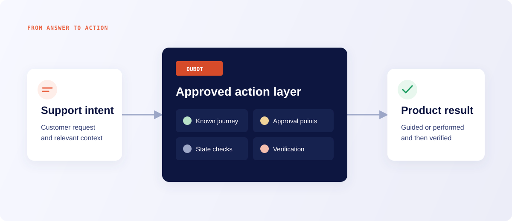

<Info>
  Current behavior is described on each product page. Features that depend on workspace access or
  an assisted rollout are labeled where they appear. Prototypes and planned concepts are not
  promises of behavior or timing.
</Info>

## Move from answers to outcomes

Dubot gives your users a copilot inside your product. They can ask a question, get shown the next step, or get help completing a task with the actions your team has enabled.

Start with the task your users get stuck on. Product and CX teams configure the experience, while engineering connects the SDK, product context, and supported actions.

## Experiences customers use

<CardGroup cols={3}>
  <Card title="Copilot" icon="panel-right" href="/product/resource-center">
    A page-aware conversation with a task composer, suggested prompts, relevant resources, optional attachments, and launches into reviewed guides or host actions.
  </Card>
  <Card title="Wizards" icon="message-circle" href="/product/wizards">
    Placed assistants that combine instructions, knowledge, and capabilities for a focused job.
  </Card>
  <Card title="Guidance" icon="mouse-pointer-click" href="/product/guidance">
    Reviewed walkthroughs and goal-based help that work with the customer's live interface.
  </Card>
</CardGroup>

## What powers them

<CardGroup cols={3}>
  <Card title="Capabilities" icon="blocks" href="/product/capabilities-actions">
    Reusable bundles of instructions and context. Skill capabilities can also carry actions.
  </Card>
  <Card title="Knowledge" icon="book-open" href="/product/knowledge">
    One searchable workspace corpus, with explicit scope for each agent experience.
  </Card>
  <Card title="Actions" icon="zap" href="/product/capabilities-actions">
    Reviewable product operations and client-side callbacks that Skill capabilities make
    available to an agent.
  </Card>
</CardGroup>

## How teams work with Dubot

<Steps>
  <Step title="Choose a customer outcome">
    Start with a recurring task that is valuable, measurable, and safe to bound.
  </Step>
  <Step title="Assemble the experience">
    Choose a Copilot, wizard, or Guidance journey. Attach the capabilities, knowledge,
    actions, and content needed for that outcome.
  </Step>
  <Step title="Integrate the browser SDK">
    Add one CDN script, identify the signed-in user, and register the context or callbacks your
    product owns.
  </Step>
  <Step title="Test, then publish">
    Test reads the latest saved configuration. Production reads only explicitly published
    versions.
  </Step>
  <Step title="Inspect the result">
    Review conversations, action outcomes, guidance runs, and workspace-level analytics before
    expanding scope.
  </Step>
</Steps>

## Pick a path

<CardGroup cols={3}>
  <Card title="Launch your first experience" icon="flag" href="/start/first-value">
    Take one small customer job from workspace setup through Production verification.
  </Card>
  <Card title="Install the SDK" icon="code" href="/sdk/quickstart">
    Add Dubot to a browser application.
  </Card>
  <Card title="Plan an evaluation" icon="clipboard-check" href="/pilots/pilot-guide">
    Prove one customer outcome with clear controls and evidence.
  </Card>
</CardGroup>
