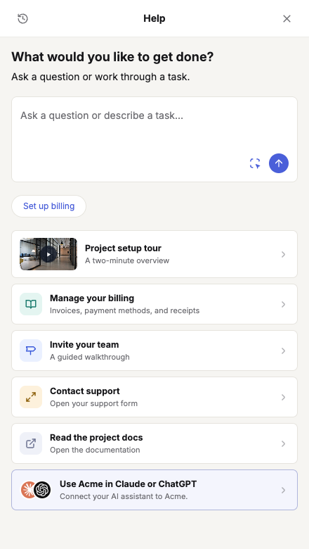

Copilot gives users a place to ask a question or work through a task without leaving your product. It brings together conversation, suggested prompts, relevant resources, and launches into reviewed guides or host actions.

<Note>
  Copilot was previously called Resource Center. Existing page URLs, `resourceCenter` configuration keys, `resourceCenterCallbacks`, and the reserved `resource-center` agent slug retain their technical names. The dashboard calls the experience **Copilot**.
</Note>

## Start with what the user wants to get done

The home panel leads with a task composer. A user can describe their goal, choose a suggested prompt, or open a relevant resource. The conversation uses the current route and resolved Copilot items as context.

<Frame caption="The current SDK Copilot home with a task composer, suggested prompt, contextual resources, and chat history. Sample content from Storybook.">
  
</Frame>

The [interactive SDK Storybook](https://dubot-sdk-storybook.pages.dev/?path=/story/chat-resource-center--open-contextual-home) uses the real panel and chat components with scripted example replies. It demonstrates the interface, not a live connection to a customer's account.

## One experience per workspace

Each workspace has one versioned Copilot with **Content**, **Agent**, **Settings**, and **Analytics** tabs. Its reserved agent saves and publishes with the Copilot. It is not a separately placed wizard and has no independent publish lifecycle.

Use **All pages** for shared resources. Add exact-path or prefix overrides to tailor the experience to the current page. Overrides can pin, hide, and order resources without duplicating the default list.

## Conversation and context

- **Ask in your own words** is the primary path. Configure its prompt, knowledge, and Skills in **Agent**.
- **Prompt** items appear as suggestion chips. Selecting a chip starts a conversation with its authored prompt.
- Users can point at things on the page when page-element attachments are enabled.
- File uploads are optional. Configure allowed file types and upload availability in **Agent**.
- Chat history lets users return to recent conversations.
- Actions reach the Copilot Agent through attached Skills. Adding a content card does not grant the agent a new tool.

The current home uses a conversation composer rather than separate Search and Ask launch cards. Knowledge retrieval supports answers according to the agent's configured scope. Curated static cards are not automatically part of that knowledge corpus.

## Resources and task paths

| Item | What the user gets |
| --- | --- |
| Prompt | A suggested request that starts a conversation |
| Guide | A published, reviewed walkthrough |
| Help Center article | An external article opened at its source |
| Video embed | A video shown within the panel |
| Hyperlink | A destination opened in the configured tab |
| Callback | A registered host action invoked when the user selects the card |
| MCP connector | Connection details when the workspace's action channel is enabled |

Guide availability depends on published Guidance configuration and a compatible SDK. Host callbacks must be registered by the application. An MCP card does not by itself enable a connection or grant consent.

## Show the way or help do the work

A Copilot conversation can launch [Guidance](/product/guidance) when that capability is configured. **Show** leaves host interactions to the user. **Do** permits automation in agent-owned stages while preserving explicit user handoffs. When Guidance runs, the panel yields space to the on-page experience; the conversation remains available afterward.

## Display and launch

Use **Settings** for the panel title, welcome text, composer placeholder, page availability, and trigger.

| Trigger | Behavior |
| --- | --- |
| Floating | Dubot renders the launcher |
| Injected | Dubot mounts the trigger into a matching host selector |
| Auto-open | The panel opens when its targeting conditions match |
| Programmatic | Your application calls `Dubot.openCopilot()` |

A mounted agent Sidebar takes priority over the base Copilot launcher and home panel.

## Publish and measure

Save the draft, test a representative route and task, then use the Copilot page's **Publish** action. Publish its required guides, Skills, actions, and Guidance configuration for the target environment as well. Saving a draft does not update Production.

Use **Analytics** to inspect panel opens, unique viewers, item impressions and clicks, and chat submissions. Historical search metrics may also appear. Analytics aggregates do not retain raw search or question text; conversation records have their own scope.

Follow [Configure and publish Copilot](/guides/configure-resource-center) for the setup workflow and [SDK surfaces](/sdk/surfaces#copilot) for programmatic launch.
